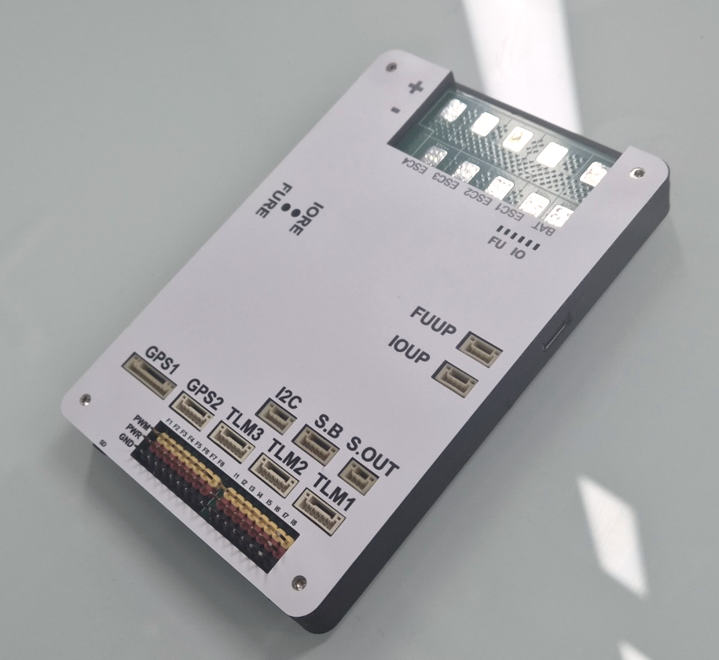

# DCD FC

[한국어](README_KO.md) · [Purchase and technical support](https://www.d-class.co.kr)

DCD FC is a flight controller with integrated power distribution from Corp.DCLASS. It combines flight control, peripheral connections and battery power pads for four external ESCs.

## Downloads

| Resource | Link |
| --- | --- |
| User manuals · REV8 | [English PDF](DCD_FC_Manual_EN_REV8.pdf) · [한국어 PDF](DCD_FC_Manual_KO_REV8.pdf) |
| Development firmware · ArduCopter 4.8.0-dev | [Download APJ · f283ff97](firmware/DCD_FC_ArduCopter_f283ff97.apj) |
| Firmware installation | [English](INSTALL.md) · [한국어](INSTALL_KO.md) |
| Connections, LEDs and configuration | [English](docs/REFERENCE_EN.md) · [한국어](docs/REFERENCE_KO.md) |

DCD-FC support was merged into ArduPilot on **24 November 2026** ([#34796](https://github.com/ArduPilot/ardupilot/pull/34796)). As of 25 November 2026, DCD-FC downloads are not yet listed on the [official firmware server](https://firmware.ardupilot.org). The APJ above is our existing development build, not an official stable release.

## Features

- STM32H743 main processor and STM32F103 IO processor.
- BMI088 and ICM-42688-P IMUs, MS5611 barometer and IST8310 compass.
- 16 PWM outputs; bidirectional DShot on F1–F8 and I1–I4.
- Two GPS ports, three telemetry ports, I2C, SBUS and USB.
- FRAM parameter storage and microSD logging.
- 3–6S LiPo input, maximum **25.2 V**.
- Enclosure: approximately **126 × 84 × 13 mm**; **103 g** with enclosure.

The manuals include connector pinouts, wiring diagrams, dimensions, mounting orientation and power specifications. Default battery monitoring is voltage only (`BATT_MONITOR=3`). Optional current monitoring (`4`) excludes ESC propulsion current. See the [configuration reference](docs/REFERENCE_EN.md).

## Developer resources

[Official board source](https://github.com/ArduPilot/ardupilot/tree/master/libraries/AP_HAL_ChibiOS/hwdef/DCD-FC) · [Matching source and build instructions](docs/SOURCE.md) · [Test record](docs/TESTING.md) · [SHA-256 checksums](SHA256SUMS.txt) · [Licenses](LICENSES.md)

[Earlier versions](archive/README.md) are retained for reference.

## Purchase and technical support

[Corp.DCLASS — www.d-class.co.kr](https://www.d-class.co.kr)
