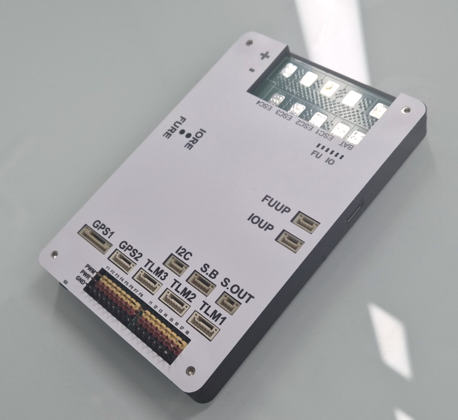

# DCD FC

[English](README.md) · [구매 및 기술지원](https://www.d-class.co.kr)

DCD FC는 Corp.DCLASS의 전원 분배 일체형 비행제어기입니다. 비행 제어, 주변기기 연결, 외부 ESC 4개의 배터리 전원 연결을 한 보드에 통합했습니다.

## 다운로드

| 자료 | 링크 |
| --- | --- |
| 사용 매뉴얼 · REV8 | [한글 PDF](DCD_FC_Manual_KO_REV8.pdf) · [English PDF](DCD_FC_Manual_EN_REV8.pdf) |
| 개발 펌웨어 · ArduCopter 4.8.0-dev | [APJ 다운로드 · f283ff97](firmware/DCD_FC_ArduCopter_f283ff97.apj) |
| 펌웨어 설치 | [한글](INSTALL_KO.md) · [English](INSTALL.md) |
| 포트·LED·설정 안내 | [한글](docs/REFERENCE_KO.md) · [English](docs/REFERENCE_EN.md) |

DCD-FC 보드 지원은 **2026년 11월 24일 ArduPilot에 병합**되었습니다([#34796](https://github.com/ArduPilot/ardupilot/pull/34796)). 2026년 11월 25일 기준 [공식 펌웨어 서버](https://firmware.ardupilot.org)에 DCD-FC 다운로드는 아직 게시되지 않았습니다. 위 APJ는 기존 개발 빌드이며 공식 정식판이 아닙니다.

## 주요 특징

- STM32H743 메인 프로세서와 STM32F103 IO 프로세서
- BMI088·ICM-42688-P IMU, MS5611 기압계, IST8310 나침반
- PWM 16채널, F1–F8·I1–I4 양방향 DShot 지원
- GPS 2포트, 텔레메트리 3포트, I2C·SBUS·USB
- FRAM 설정 저장과 microSD 로그 기록
- 입력 전압: **3–6셀 LiPo, 최대 25.2 V**
- 케이스 외형: 약 **126 × 84 × 13 mm** / 케이스 포함 **103 g**

매뉴얼에 포트 핀 배열, 배선도, 치수, 장착 방향과 전원 사양을 수록했습니다. 기본값은 전압만 측정하는 `BATT_MONITOR=3`입니다. 전류 측정(`4`)을 선택해도 ESC 구동 전류는 포함되지 않습니다. 자세한 내용은 [설정 안내](docs/REFERENCE_KO.md)를 참고하세요.

## 개발 자료

[공식 보드 소스](https://github.com/ArduPilot/ardupilot/tree/master/libraries/AP_HAL_ChibiOS/hwdef/DCD-FC) · [대응 소스·빌드 안내](docs/SOURCE.md) · [시험 기록](docs/TESTING_KO.md) · [파일 체크섬](SHA256SUMS.txt) · [라이선스](LICENSES.md)

[이전 버전](archive/README.md)은 참고용으로 보존합니다.

## 구매 및 기술지원

[Corp.DCLASS — www.d-class.co.kr](https://www.d-class.co.kr)
