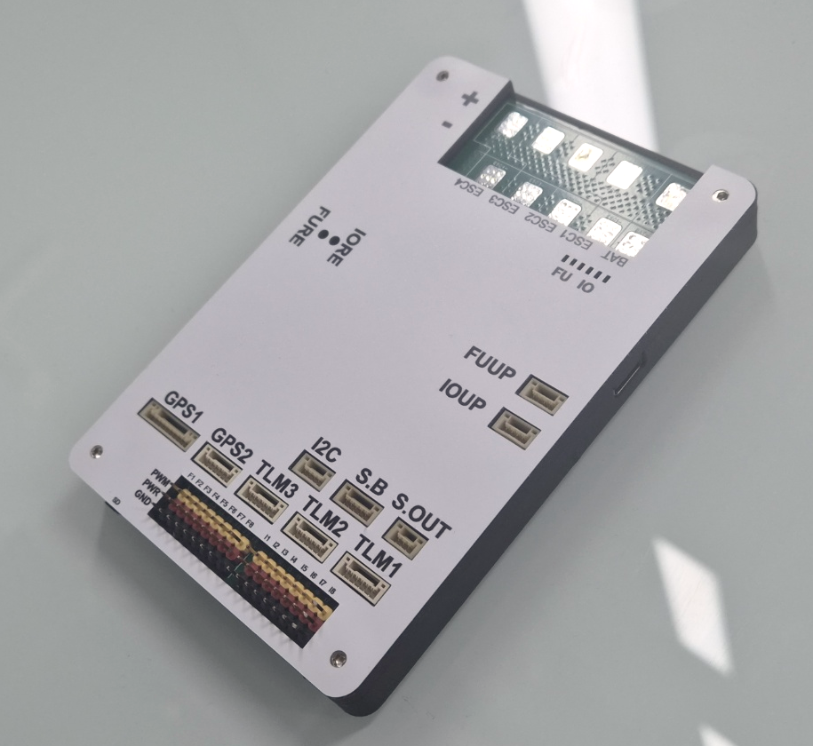

# DCD FC

[English](README.md) · [구매 및 기술지원](https://www.d-class.co.kr)

DCD FC는 Corp.DCLASS의 전원 분배 일체형 비행제어기입니다. 비행 제어, 주변기기 연결, 외부 ESC 4개의 배터리 전원 연결을 한 보드에 통합했습니다.

## 주요 특징

- STM32H743 메인 프로세서와 STM32F103 IO 프로세서
- BMI088·ICM-42688-P IMU, MS5611 기압계, IST8310 나침반
- PWM 16채널, GPS 2포트, 텔레메트리 3포트, I2C·SBUS·USB
- FRAM 설정 저장과 microSD 로그 기록
- 입력 전압: 3–6셀 LiPo, 최대 25.2 V
- 케이스 외형: 약 126 × 84 × 13 mm / 케이스 포함 103 g

## 매뉴얼

- [한글 매뉴얼 — REV1](DCD_FC_Manual_KO_REV1.pdf)
- [영문 매뉴얼 — REV1](DCD_FC_Manual_EN_REV1.pdf)

포트 핀 배열, 배선도, 치수, 장착 방향과 전원 사양을 수록했습니다. BAT·ESC 전원 패드 쪽이 Front이며, FC는 양면테이프로 기체에 고정합니다.

내장 전류 센서는 배터리에서 FC·주변기기·PWM 전원으로 공급되는 전류를 측정합니다. ESC 구동 전류는 포함하지 않습니다. 기체 전체 배터리 소모량 측정에는 외부 전류 센서가 필요합니다.

## 부트로더와 펌웨어

[Release downloads / 릴리스 다운로드](https://github.com/LeeWonseok-kr/DCD-FC/releases/tag/test-2026-10-13)

ArduCopter 4.8.0-dev 시험용 개발 빌드입니다. 보드 ID 1413은 로컬 시험용 후보값으로, ArduPilot 공식 배정 번호가 아닙니다. 전체 실물 시험은 완료되지 않았습니다.

| 파일 | 용도 |
|---|---|
| [펌웨어 APJ](DCD_FC_ArduCopter_4.8.0-dev.apj) | 같은 보드 ID의 부트로더에서 Mission Planner로 갱신 |
| [통합 HEX](DCD_FC_ArduCopter_with_Bootloader.hex) | FMU 최초 설치: 부트로더와 펌웨어 |
| [부트로더 HEX](DCD_FC_Bootloader.hex) / [BIN](DCD_FC_Bootloader.bin) | FMU 부트로더 |
| [IO 부트로더 HEX](DCD_FC_IO_Bootloader.hex) / [BIN](DCD_FC_IO_Bootloader.bin) | STM32F103용 순정 IO 부트로더 · IOUP 전용 |
| [IO 부트로더 패키지](DCD_FC_IO_Bootloader_Package.zip) | IO BIN·HEX, 대응 소스와 빌드 안내 |
| [펌웨어 BIN](DCD_FC_ArduCopter_4.8.0-dev.bin) | FMU 응용 펌웨어 원시 이미지 |

[설치 안내](INSTALL_KO.md) · [파일 해시](SHA256SUMS.txt) · [소스 및 빌드 방법](SOURCE.md)

펌웨어는 ArduPilot 기반 GPL-3.0-or-later 소프트웨어이며, 해당 빌드의 소스와 원저작권·라이선스를 함께 제공합니다.

## 구매 및 기술지원

[Corp.DCLASS — www.d-class.co.kr](https://www.d-class.co.kr)
